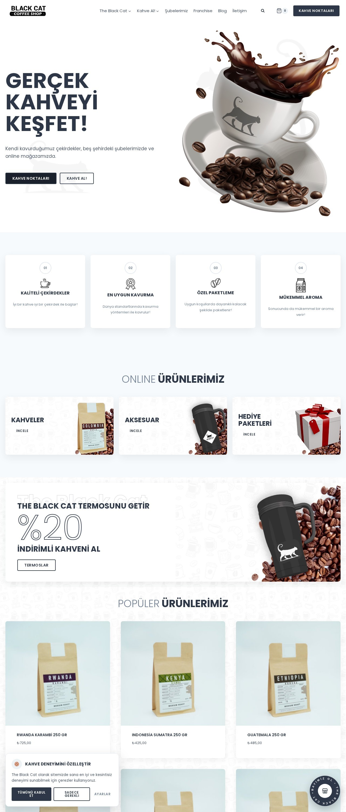
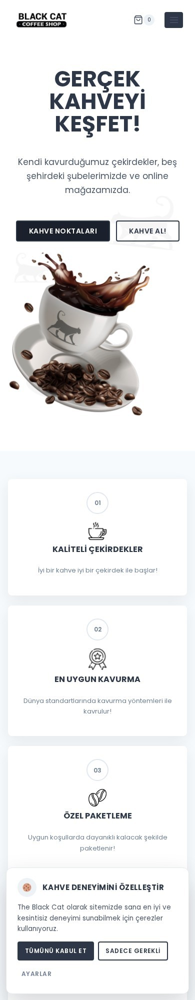
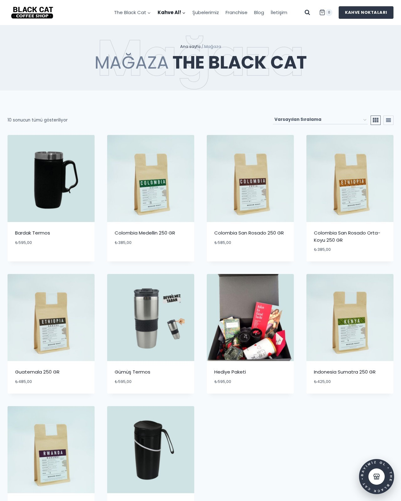
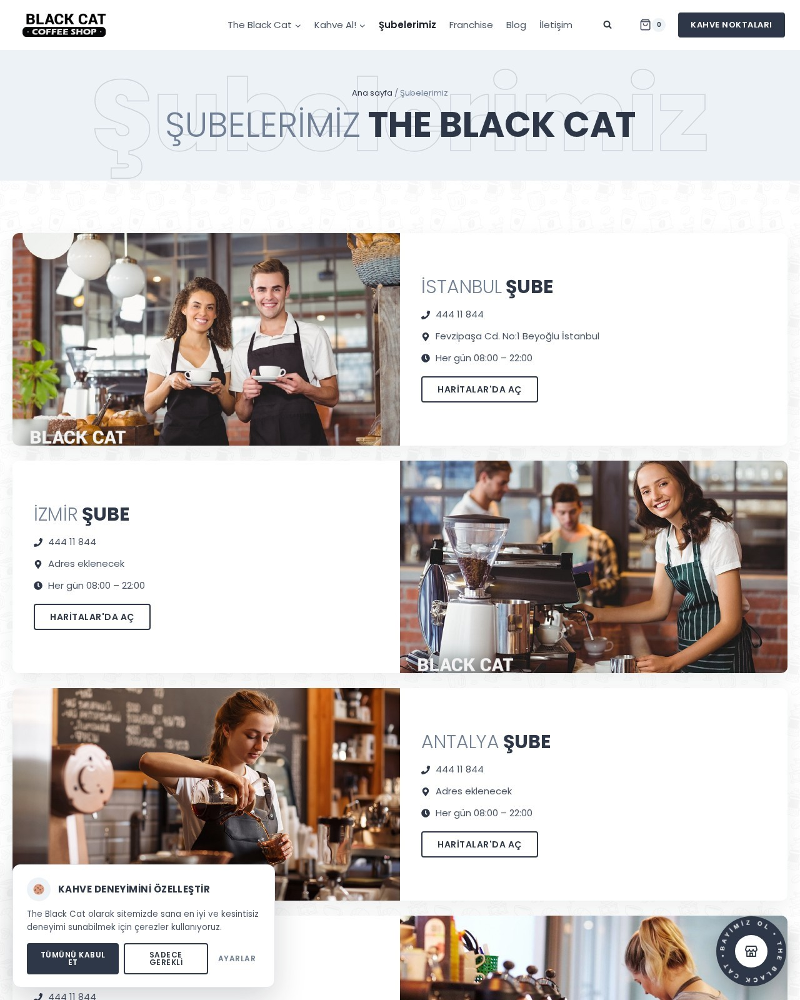
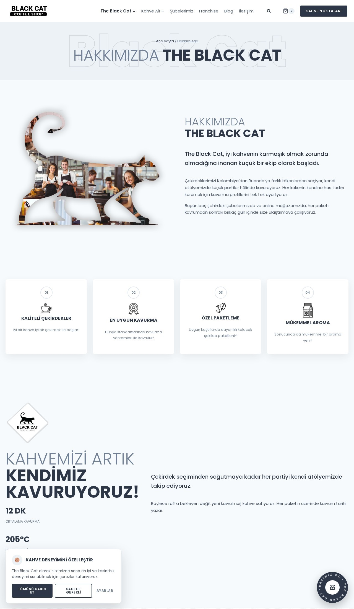
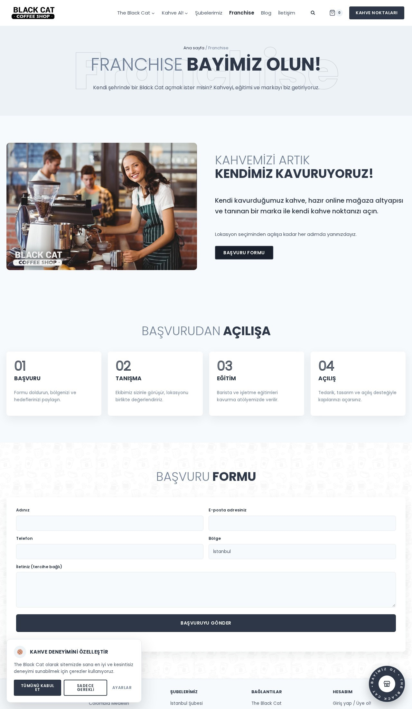
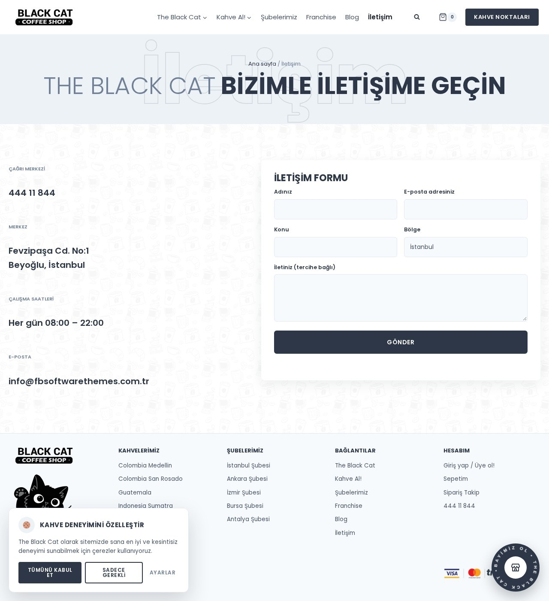

# The Black Cat Coffee Shop

Redesign of the Black Cat Coffee Shop website (Turkish, WordPress + Kadence + Elementor).

- Old site: https://fbsoftwarethemes.com.tr/blackcat/
- New site (live): https://fbsoftwarethemes.com.tr/theblackcatcoffeeshop/

## Ekran görüntüleri (live theme)

| Ana sayfa | Mobil |
|---|---|
|  |  |

| Mağaza | Şubelerimiz |
|---|---|
|  |  |

| Hakkımızda | Franchise | İletişim |
|---|---|---|
|  |  |  |

## Mockups

Both are clickable, single-file HTML mockups with every page (use the "Sayfa" menu in the top bar).

| Folder | Look |
| --- | --- |
| `mockups/brand/` | The live brand: white, slate `#2D3748`, Poppins, doodle pattern, outline type, the site's own images. **This is the version being built.** |
| `mockups/dark/` | Alternative direction: dark espresso with a cat-eye amber accent, Pexels photography. |

Open `mockups/brand/index.html` or `mockups/dark/index.html` in a browser.

Pages: Ana sayfa, The Black Cat (Hakkımızda), Mağaza (Kahveler / Aksesuarlar / Hediye Paketleri), Ürün sayfası, Şubelerimiz, Franchise, Blog, Blog yazısı, İletişim, Hesabım.

## Assets

- `assets/site-images/` – original full-size images from the old site (35 files).
- `assets/pexels/` – free Pexels photos used in the dark mockup (see `CREDITS.txt`, Pexels License).

## Placeholder content to replace

- About, Franchise and blog texts are drafts (the old site had lorem ipsum / default WordPress text).
- Branch addresses (all five share the Beyoğlu address on the old site), opening hours, coffee origin details.
